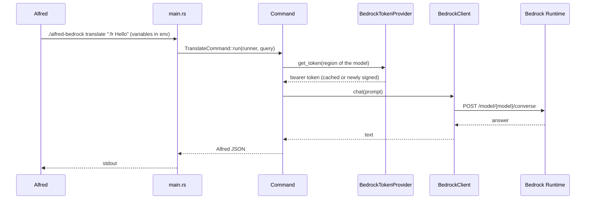

# Architecture

The workflow is one native binary, `alfred-bedrock`, called by Alfred for each query. It reads its configuration from the environment variables Alfred sets, calls Amazon Bedrock and prints a Script Filter JSON document on stdout. It keeps no process running between queries: state that must survive, such as SSO tokens and Bedrock keys, lives in a cache file.

## Why a native binary

Alfred runs workflow scripts with a minimal environment: no shell profile, and a `PATH` limited to `/usr/bin:/bin:/usr/sbin:/sbin`. The 1.x TypeScript workflow had to find `node` in that environment, which broke whenever the Node.js setup changed (fnm, asdf, Homebrew upgrades).

Version 2 is a Rust binary that only links macOS system libraries. TLS and its root certificates are compiled in (`ureq` with rustls), so the workflow runs with an empty environment. The only external program it may need is the AWS CLI, for the optional `aws_profile` mode, and it is located without relying on the `PATH` (see [authentication](authentication.md#aws-cli-profile)).

## Request flow

1. Alfred runs `./alfred-bedrock <command> "$1"` from a Script Filter. The three entry points of each command (keyword, Universal Action, hotkey) feed the same Script Filter.
2. `main.rs` collects the arguments and the environment, builds the adapters and dispatches to `AspellCommand`, `BedrockCommand` or `TranslateCommand`.
3. The command builds its prompt (system prompt, translation target) and calls `CommandRunner::ask`.
4. `CommandRunner` reads `model` and `level`, gets a bearer token from `BedrockTokenProvider` and sends the prompt through `BedrockClient`.
5. The answer becomes a single Alfred item: Enter opens it in Text View, ⌘↵ copies it, ⌥↵ pastes it.

Every error is turned into an Alfred item titled `Error: …` (with its context chain), so a failure is always visible in Alfred instead of an empty result.

## Modules

| Module | Role |
| --- | --- |
| `main.rs` | Composition root: reads arguments and variables, wires `UreqHttpClient` and `BrowserLauncher`, prints the JSON |
| `command/` | One type per Alfred command, plus `CommandRunner` that resolves the model, the effort level and the token |
| `service/` | Token resolution (`BedrockTokenProvider`), credentials sources and the IAM Identity Center login (`SsoAuthService`) |
| `client/` | Bedrock Runtime, IAM Identity Center OIDC and portal APIs, AWS CLI, and the `ureq` HTTP adapter |
| `helper/` | Pure logic and small utilities: SigV4 key signing, model features, region detection, translation prefix, Alfred JSON, cache file |
| `types/` | Shared structs and traits, one per file |
| `error/` | `SsoUnauthorizedError`, the only error matched by type |

## Ports

Two traits isolate the side effects that cannot run in tests:

| Trait | Production adapter | Test double |
| --- | --- | --- |
| `HttpClient` | `UreqHttpClient`: blocking HTTPS, non-2xx statuses returned as responses | `StubHttpClient`, `FakeIdentityCenter` |
| `UrlOpener` | `BrowserLauncher`: `/usr/bin/open [-a <browser>] <url>`, HTTPS URLs only | `RecordingOpener` |

They are created once in `main.rs` and passed down through constructors. The AWS CLI and the cache file are not abstracted: tests run a fake `aws` script and a real file in a temporary directory.

## Configuration

All settings are Alfred workflow variables, read from the environment. Empty values count as unset.

| Variable | Used by | Default |
| --- | --- | --- |
| `model` | `CommandRunner` | `eu.anthropic.claude-haiku-5-5` |
| `level` | `CommandRunner` | `low` |
| `default_lang` | `TranslateCommand` | `en` |
| `token`, `aws_profile`, `aws_cli_path`, `sso_*`, `AWS_BEARER_TOKEN_BEDROCK` | `BedrockTokenProvider` | see [authentication](authentication.md) |
| `browser` | `BrowserLauncher` | default browser |
| `alfred_workflow_cache` | `BedrockTokenProvider` | `~/.cache/alfred-bedrock-workflow` |

Authentication variables are listed in `variablesdontexport` in `info.plist`, so exporting the workflow never shares them.
