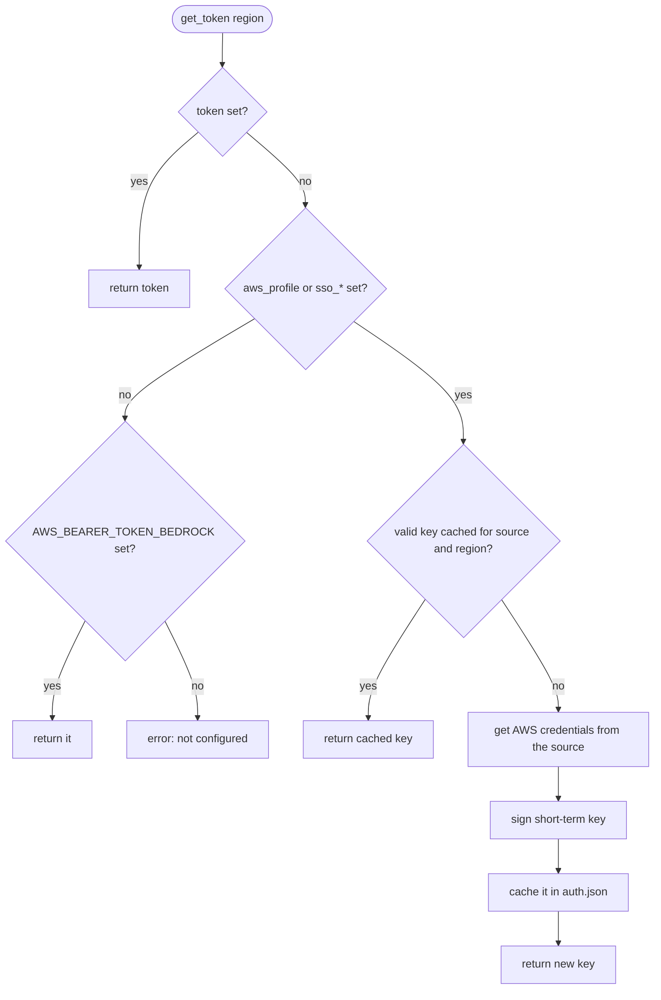
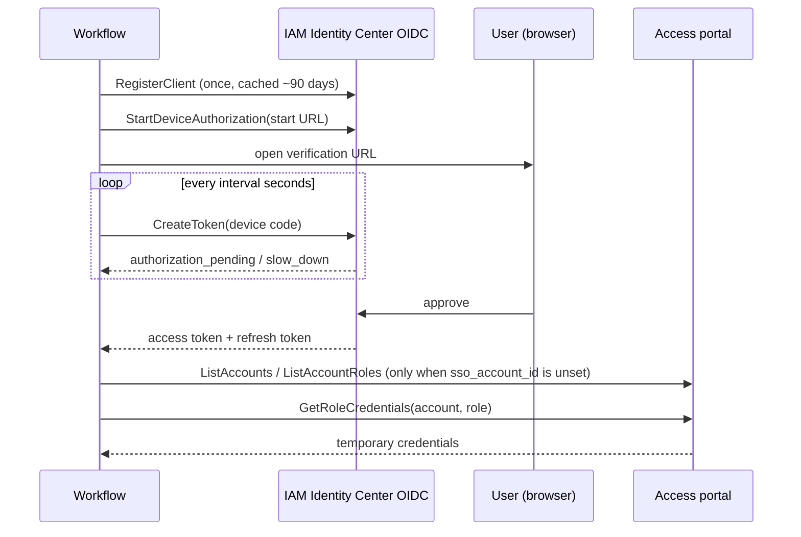

# Authentication

Bedrock accepts a bearer token (an API key) instead of SigV4-signed requests. The workflow either uses a token you provide, or signs a short-term key itself from AWS credentials and caches it.

## Resolution order

`BedrockTokenProvider::get_token(region)` returns the first available token:

1. **`token`**: a static Bedrock API key, used as is.
2. **A credentials source**, when configured:
   - `aws_profile` → `AwsProfileCredentialsSource`
   - otherwise `sso_start_url` + `sso_role_name` → `SsoCredentialsSource`

   The source provides AWS credentials, which sign a short-term key for the region (see below).
3. **`AWS_BEARER_TOKEN_BEDROCK`**: checked last, so an old token left in the environment never hides an explicit configuration.

Setting only one of `sso_start_url` and `sso_role_name` is an error.

## Short-term keys

A Bedrock short-term key is a presigned URL of the `CallWithBearerToken` action, valid for up to 12 hours, base64-encoded with the `bedrock-api-key-` prefix. `BedrockTokenGenerator` builds it locally with SigV4 (HMAC-SHA256), byte for byte like AWS's `@aws/bedrock-token-generator`; a unit test pins a reference key.

- Keys are bound to a region: switching between EU and US models signs one key per region.
- The IAM principal needs `bedrock:CallWithBearerToken` in addition to the model invocation permissions.
- A key cannot outlive the credentials that signed it: it is cached until `min(signature time + 12h, credentials expiration)`, and replaced 5 minutes before that.

## AWS CLI profile

`aws_profile` delegates the whole login to the AWS CLI and its configuration:

1. `aws configure export-credentials --profile <profile> --format process` returns the credentials, whatever the profile type (IAM Identity Center, `credential_process` such as Granted, static keys).
2. If the CLI reports an expired IAM Identity Center session, the workflow runs `aws sso login --profile <profile>` once and retries. Other errors are reported as is.

Each call is limited to 2 minutes, enough to approve a browser login without blocking Alfred indefinitely.

Since Alfred provides no useful `PATH`, `AwsCliClient` locates the CLI itself:

1. `aws_cli_path`, when set;
2. `/opt/homebrew/bin/aws`, then `/usr/local/bin/aws`;
3. `aws` from the inherited `PATH`.

The CLI then runs with its own directory, `/opt/homebrew/bin` and `/usr/local/bin` prepended to its `PATH`, so that `credential_process` helpers installed next to it or with Homebrew resolve.

## IAM Identity Center

Without the AWS CLI, `SsoCredentialsSource` logs in to IAM Identity Center itself, with the OAuth device authorization grant, then fetches role credentials from the access portal.

`SsoAuthService` gets an access token in this order:

1. the cached access token, while it is valid for at least another minute;
2. the refresh token, which renews the access token silently while the IAM Identity Center session lasts;
3. an interactive browser login.

Edge cases it handles:

- **Alfred kills the process while you approve the login.** The device authorization is saved before the browser opens; the next query resumes polling it instead of opening another tab.
- **The SSO session is revoked.** The portal answers 401 (`SsoUnauthorizedError`): the access token is dropped and the login runs again, once.
- **The client registration expires.** A new client is registered a day before expiry; tokens issued to the previous client are discarded.
- **`sso_account_id` is unset.** Every account is searched for the role, in parallel; the account is resolved once and cached. Several matches are an error asking for `sso_account_id`.

## Cache file

State is stored in `$alfred_workflow_cache/auth.json`, created with mode `0600` in a `0700` directory and replaced atomically (temporary file, then rename). The format is the one of the 1.x TypeScript workflow, so upgrading keeps the session.

| Field | Content |
| --- | --- |
| `scope` | Owner of the state: `profile:<profile>` or `sso:<start URL>\|<region>`. State from another scope is ignored, so switching configuration starts clean |
| `bedrockKeys` | Short-term keys by `<source key prefix>:<region>`, with their expiry; expired keys are pruned on write |
| `registration` | OIDC client id, secret and expiry |
| `ssoToken` | Access token, expiry and refresh token |
| `pendingAuthorization` | Device authorization awaiting approval |
| `resolvedAccountIds` | Account found for each role name |

Times are epoch milliseconds. Delete the file to force a new login.
